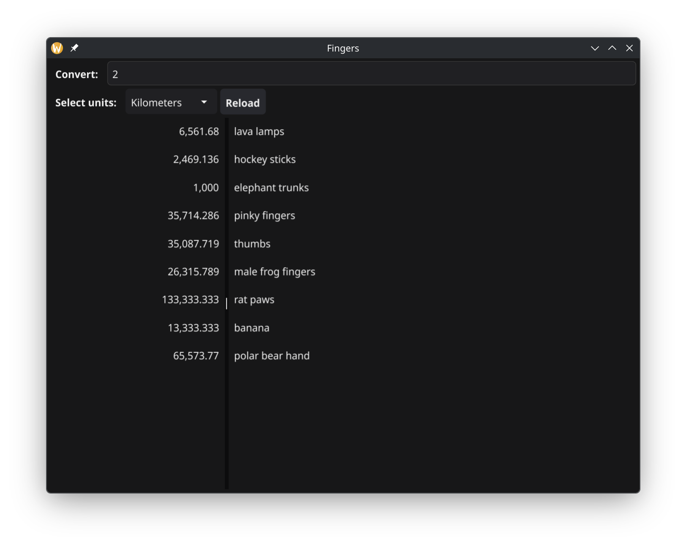
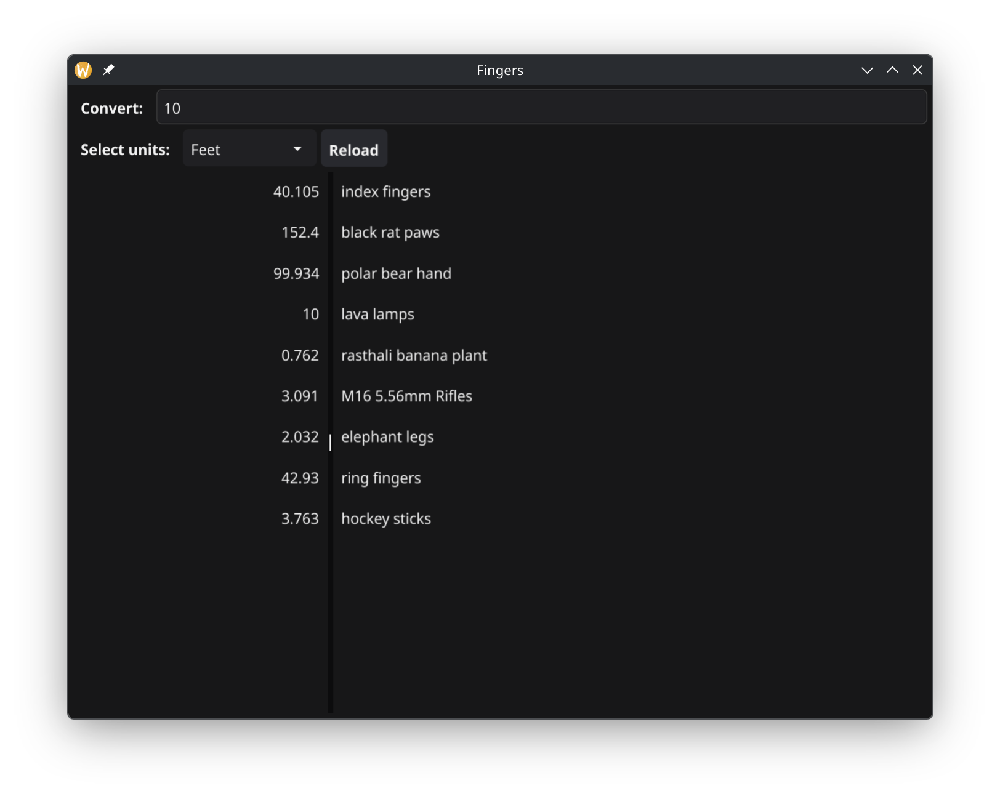

# Fingers

Fingers is a desktop GUI program made for converting distance units from human to american.
Find out more by installing it yourself or looking at the screenshots!

## Get started

The only way (currently) to get Fingers is to build manually:

### Using Go

```shell
go install go.pmjlab.com/fingers
```

Keep in mind the build requirements for the GUI toolkit.

### Build requirements

- Go 1.26 or newer
- A C compiler and devel libraries required by [fyne.io](https://docs.fyne.io/started/quick/)

## Screenshots

<div style="display: flex; flex-wrap: wrap; gap: 10px;">
  
  
</div>

## License

Licensed under the terms of the [MIT License](LICENSE).
